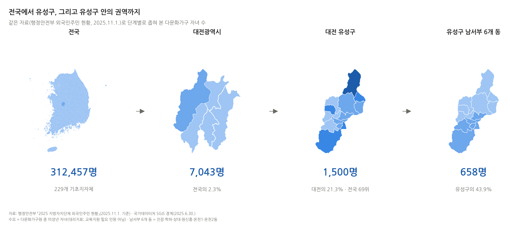
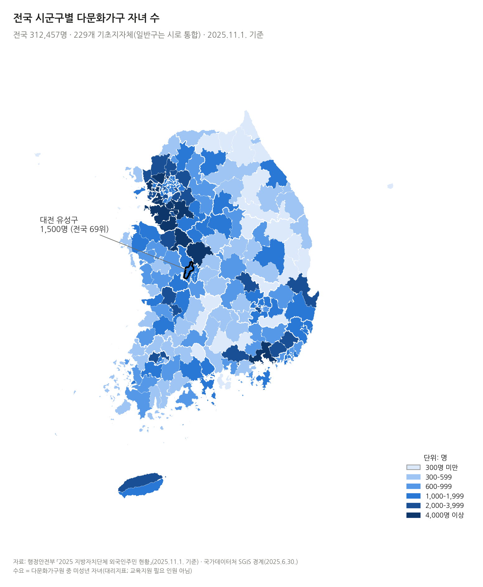
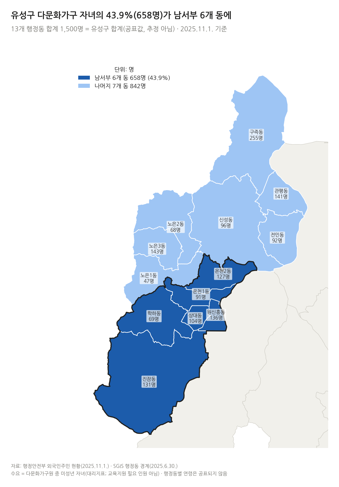
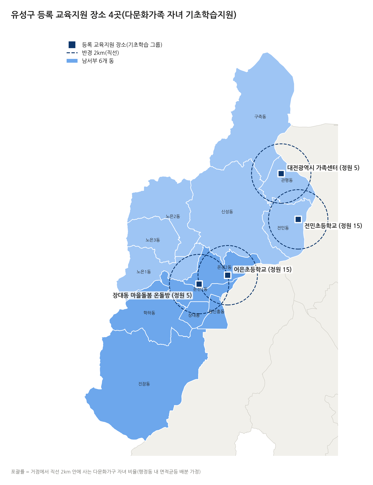
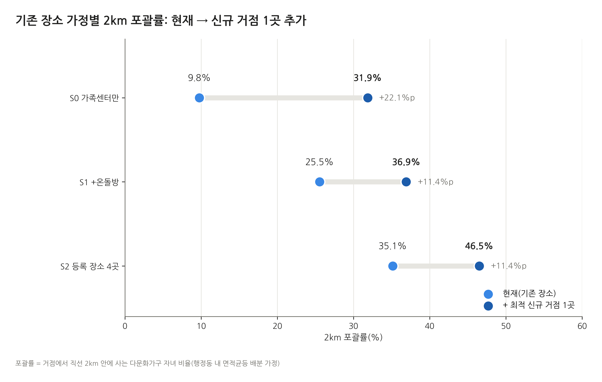
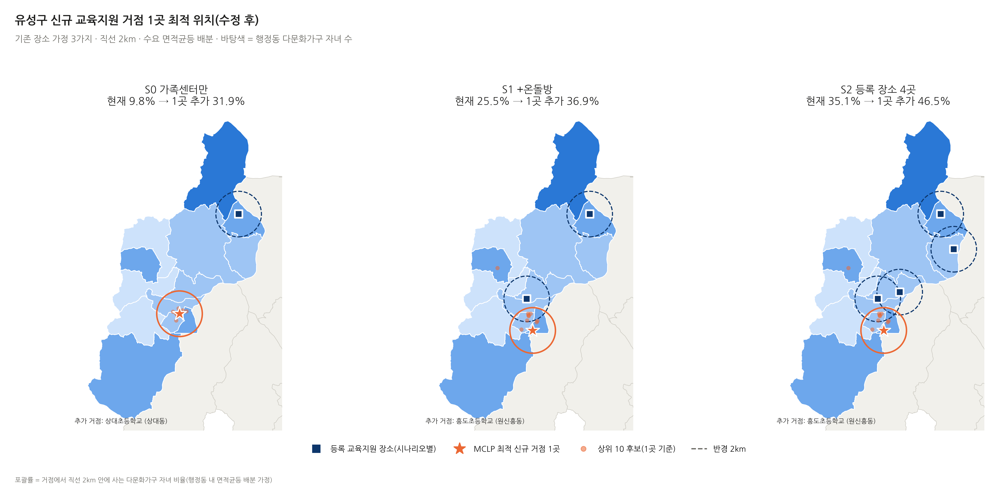
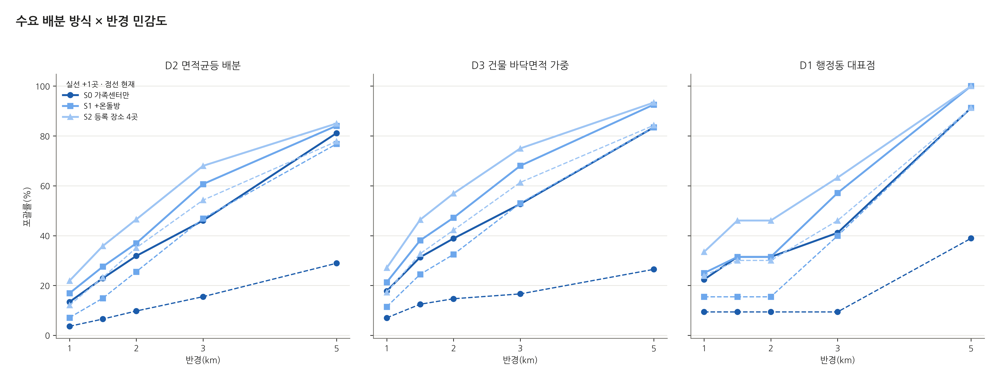
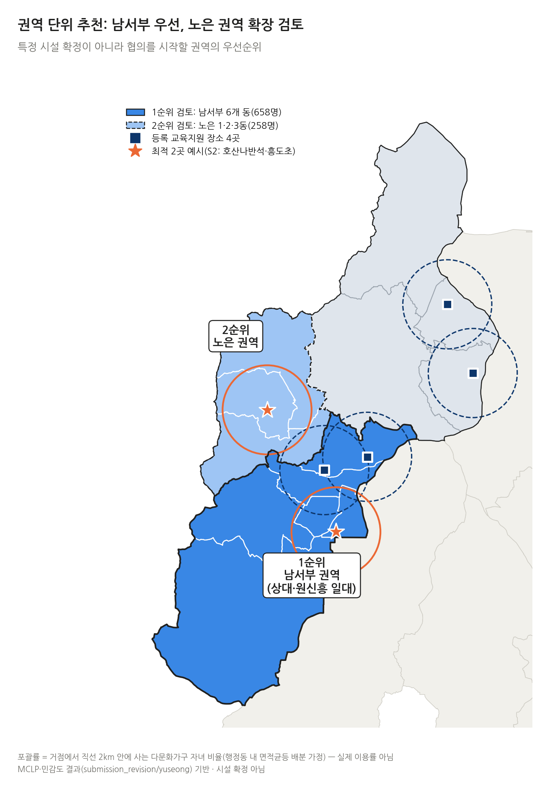
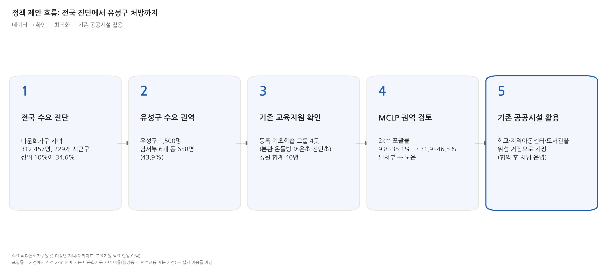

<div align="center">

# 유성구 다문화가정 아동 교육지원 거점 입지 분석

### 전국 수요 진단에서 대전 유성구 위성 학습거점 입지 제안까지

</div>

<p align="center">
  
</p>

> **“다문화가정 아동을 위한 교육지원 프로그램이, 그 아동들이 실제로 사는 곳 가까이에 있는가?”**
>
> 기초학습 프로그램은 3~5개월 동안 **정기적으로 여러 번 다녀야** 하는 프로그램입니다. 초등학생은 혼자 멀리 이동하기 어렵고, 보호자가 데려가야 한다면 거리는 곧 보호자의 시간 부담이 됩니다. 이 프로젝트는 공공데이터로 **수요가 있는 곳과 지원 장소 사이의 공간적 거리**를 측정하고, 최대포괄입지모형(MCLP)으로 **어디에 거점을 더하면 가장 많은 아동이 가까워지는지**를 찾습니다. 전국 시군구 단위의 수요·공급 비교도 함께 들어 있습니다.

---

## 📌 한눈에 보는 결론

| 질문 | 답 |
|---|---|
| 전국에 다문화가정 아동은 얼마나, 어디에? | 다문화가구 미성년 자녀 **312,457명**(2025.11.1.). 상위 10%인 **23개 시·군·구에 34.6%** 집중 |
| 유성구는? | **1,500명**(전국 229곳 중 69위). 13개 행정동에 넓게 퍼져 있고, **남서부 6개 동에 658명(43.9%)** |
| 지금 교육지원은 어디서? | 가족센터 본관(관평동) 외에 장대동 마을돌봄 온돌방·어은초·전민초에서도 기초학습 그룹 운영 등록. **4곳, 정원 합계 40명** |
| 지금 얼마나 가까이 있나? | 직선 2km 안의 자녀 비율: 본관만 보면 **9.8%**, 등록 장소 4곳을 모두 보면 **35.1%** |
| 거점 1곳을 더하면? | 포괄률 **31.9~46.5%** (+11.4~22.1%p), 추가 포괄 약 **171~331명** |
| 어디부터? | **1순위 남서부(상대·원신흥동 일대)**, **2순위 노은 권역** — 45개 조건 민감도로 확인 |

> ⚠️ **포괄률 = 거점에서 직선 2km 안에 사는 다문화가구 자녀 비율**(행정동 내 면적균등 배분 가정)입니다.

---

## 🧭 분석 흐름

```
전국 수요 진단 → 유성구 행정동 수요 → 기존 교육지원 장소 확인 → 후보 시설 정리·좌표 보정
→ 수요 공간 배치(D1/D2/D3) → MCLP 최적화(기존 거점 가정 S0/S1/S2) → 민감도 45개 조건 → 권역 추천 → 정책 제안
```

| 단계 | 내용 |
|---|---|
| **수요 정의** | 행정안전부 「지방자치단체 외국인주민 현황」의 **‘다문화가구원 중 자녀’**(미성년, 대략 0~18세)를 교육지원 **잠재 수요의 대리지표**로 사용 |
| **수요 공간 배치** | 유성구를 **100m 격자**로 나누고 행정동 수요를 3가지 방식으로 배치 — D2 면적균등(기본) · D3 OSM 건물 바닥면적 가중 · D1 행정동 대표점 |
| **기존 거점 가정** | S0 가족센터 본관만 · S1 본관+장대동 온돌방 · S2 등록 장소 4곳 전체 |
| **후보 시설** | 지역아동센터, 초·중학교, 행정복지센터, 도서관 등 **107곳** (공식 표준데이터 좌표로 보정) |
| **MCLP** | k=1은 전수 비교, k=2·3은 **모든 조합을 열거하는 정확해** |
| **민감도** | 기존 거점 가정 3 × 수요 배치 3 × 반경 5(1, 1.5, 2, 3, 5km) = **45개 조건** |

---

## 📊 주요 결과

### 1. 전국과 유성구의 수요

<table>
  <tr>
    <td width="50%"></td>
    <td width="50%"></td>
  </tr>
  <tr>
    <td align="center"><sub>전국 시·군·구별 다문화가구 자녀 수 (312,457명)</sub></td>
    <td align="center"><sub>유성구 남서부 6개 동에 658명(43.9%)</sub></td>
  </tr>
</table>

- 상위 시·군·구: 경기 화성시(7,189) · 안산시(7,181) · 시흥시(6,428) · 수원시(6,342) · 부천시(6,298)
- 유성구는 특정 동이 아니라 **구 전체에 퍼진 수요**인데, 가족센터 본관은 구의 한쪽 끝(관평동)에 있습니다.

### 2. 등록 교육지원 장소 4곳

<p align="center">
  
</p>

| 기존 장소 가정 | 2km 포괄률 |
|---|---:|
| S0 가족센터 본관만 | 9.8% |
| S1 + 장대동 마을돌봄 온돌방 | 25.5% |
| S2 등록 장소 4곳 전체 | 35.1% |

같은 2km라도 기존 장소를 어디까지 보느냐에 따라 현재 접근성이 **9.8%에서 35.1%까지** 달라집니다. 그래서 세 가정을 모두 계산했습니다.

### 3. 신규 거점 효과 (MCLP, 직선 2km, D2)

<p align="center">
  
</p>

| 가정 | 현재 | 최적 1곳 | 1곳 추가 후 | 2곳 추가 후 | 3곳 추가 후 |
|---|---:|---|---:|---:|---:|
| S0 | 9.8% | 상대초등학교(상대동), +331명 | **31.9%** | 42.2% | 49.1% |
| S1 | 25.5% | 흥도초등학교(원신흥동), +171명 | **36.9%** | 47.2% | 53.6% |
| S2 | 35.1% | 흥도초등학교(원신흥동), +171명 | **46.5%** | 56.8% | 60.8% |

1. **어느 가정에서도 1곳 추가 효과가 분명합니다** (+22.1%p / +11.4%p)
2. **기존 장소를 넓게 볼수록 추가 효과는 작아집니다** — 본관만 가정하면 신규 거점 효과가 부풀려집니다
3. **최적 위치는 모두 남서부 안**이고, 2곳이면 **남서부 + 노은 조합**이 세 가정 모두에서 나옵니다
4. 상위 10개 후보 간 차이가 17~26명에 불과해 **시설 1곳이 아니라 ‘권역’을 추천**합니다

<p align="center">
  
</p>

### 4. 민감도: 결론은 얼마나 흔들리나

<p align="center">
  
</p>

- 15개 조건(수요 배치 3 × 반경 5) 중 최적 1곳이 남서부인 경우: **S0 12/15, S1 8/15, S2 8/15**
- 남서부가 아닌 경우는 대부분 **노은 권역**(건물 밀집을 반영한 D3, 3km 이상 반경)
- 반경과 수요 배분 방식을 바꿔도 **“1곳 추가 시 개선”이라는 방향은 같습니다**

<p align="center">
  
</p>

---

## 🏫 정책 제안: 위성 학습거점 모델

<p align="center">
  
</p>

| 역할 | 내용 |
|---|---|
| **본거점 (가족센터)** | 강사, 교재, 프로그램 설계, 참여 아동 관리 |
| **위성 거점** | 학교 방과 후 교실, 지역아동센터, 도서관, 행정복지센터의 빈 시간대 공간에서 주 1~2회 기초학습·한국어·이중언어·진로 프로그램 |
| **협의 주체** | 학교, 지역아동센터, 도서관·행정복지센터, 구청·교육지원청 |

**단계별 실행(제안)**: ① 등록 장소 실제 운영·외부 참여 여부 확인 → ② 남서부 시범 운영 → ③ 신청·출석·대기 인원으로 이용 검증 → ④ 노은 권역 확장, 다른 시·군·구에도 같은 절차 적용

> 새 제도가 아니라, 가족센터 프로그램이 이미 학교·마을 공간에서 열리고 있는 **기존 운영 방식을 데이터로 더 잘 배치하자**는 제안입니다.

---

## 🔍 검증과 수정

- **자동 검증 11개 항목 모두 통과** — 행정동 합 = 구 합계(1,500), 경계-통계 행정동 이름 13/13 일치, 격자 수요 합 = 총 자녀 수, 정확해 ≥ 탐욕해, 포괄률 단조성(k=1 ≤ 2 ≤ 3) 등
- **전국 합계 검증** — 229개 기초지자체 합 = 원표 전국값 312,457명
- **제출 전 재검증** (`_analysis/submission_revision/`)
  - 기존 교육지원 장소를 본관 1곳만 반영하던 문제 → 원자료 재확인 후 S0/S1/S2 세 가정으로 재계산
  - 지역아동센터 도로 수준 지오코딩 → 공식 표준데이터 좌표로 후보 좌표 보정
  - 전국 ‘공급 부족 순위’는 지표 정의에 따라 크게 흔들려 근거에서 제외, 전국 단위는 수요 진단만 사용

## ⚠️ 한계

| 한계 | 보완 방향 |
|---|---|
| 수요 = 다문화가구 미성년 자녀(0~18세). 실제 필요 인원·초등학생 수가 아님 | 교육지원청 학교별 다문화 학생 자료 |
| 행정동 안 실제 거주 위치를 모름 | D1·D2·D3로 범위 제시, 집계구 자료 확보 시 재계산 |
| 직선거리 기준 | 도로망·대중교통 이동시간 분석 |
| 등록 장소의 실제 운영·외부 참여, 정원·수용 능력 미확인 | 가족센터 확인, 시범 운영 신청·대기 자료 |
| 전국 프로그램 분류 표본은 1차 판독만 완료 | 이중검토 |

---

## 📁 폴더 구조

```
.
├── README.md / requirements.txt / .gitignore / LICENSE
└── _analysis/
    ├── data_dictionary.md                  변수·파일 설명
    ├── scripts/                            [1] 유성구 기본 분석
    │   ├── pipeline.py                         s01~s13 단계(파일 검증 → 수요 → 시설 → 접근성 → MCLP → 민감도)
    │   └── reports.py                          보고서·요약 생성
    ├── results/                            [1]의 결과 표(CSV)·공간자료(GPKG/GeoJSON)
    ├── nationwide/                         [2] 전국 확장 분석
    │   ├── config/config.json                  대표지역 선정 규칙·MCLP 설정(결과 확인 전에 고정)
    │   ├── src/nw_pipeline.py, nw_report.py    N1~N7 단계
    │   ├── tests/test_units.py
    │   └── results/                            시군구별 수요·공급 비교 결과
    └── submission_revision/                [3] 제출 전 재검증·수정
        ├── src/
        │   ├── r1_yuseong.py                   기존 교육지원 장소 재검증, 시나리오(S0/S1/S2)별 접근성·MCLP 재계산
        │   ├── r2a_program_classify.py         전국 가족센터 프로그램 재분류
        │   ├── r2b_supply_sensitivity.py       전국 공급 지표 민감도
        │   ├── r3_nationwide_mclp_fix.py       전국 대표지역 MCLP 재계산(후보명 버그 수정)
        │   ├── fig_make.py, fig_contact.py     제출용 그림 일괄 생성
        │   ├── fig07/10/12/13_proposal.py      제안서 삽입용 그림(각주 정리본)
        │   └── md_to_docx_pdf.py               Markdown → DOCX/PDF 변환
        ├── yuseong/                            [3]의 유성구 결과 표
        ├── nationwide/                         [3]의 전국 결과 표
        ├── figures_final/                      제안서에 넣은 최종 그림 4종
        └── figures_for_submission/01_main_figures/   핵심 그림(보고서형)
```

## ▶️ 실행 방법

### 1. 환경

Python 3.10 이상에서 확인했습니다.

```bash
python -m venv .venv && source .venv/bin/activate
pip install -r requirements.txt
```

그림에 한글을 쓰려면 [나눔고딕](https://fonts.google.com/specimen/Nanum+Gothic)의 `NanumGothic-Regular.ttf`, `NanumGothic-Bold.ttf`를 `_analysis/work/fonts/`에 넣어 주세요.

### 2. 원자료

원자료는 용량과 재배포 조건 때문에 저장소에 넣지 않았습니다. 아래 파일을 내려받아 **저장소 루트**에 두세요. `pipeline.py`는 파일 이름이 아니라 내용(SHA-256)으로 원자료를 식별하므로, 이름이 조금 달라도 동작합니다.

| 자료 | 제공처 | 기준 |
|---|---|---|
| 지방자치단체 외국인주민 현황(통계표·설명자료) | 행정안전부 | 2025.11.1. |
| 행정구역 통계 및 경계(시군구·읍면동) | 국가데이터처 SGIS | 경계 2025.6.30., 통계 2024 |
| 가족센터 프로그램 데이터 | 한국건강가정진흥원(공공데이터포털) | 2026.9.14. 게시본 |
| 전국초중등학교위치표준데이터 | 공공데이터포털 | — |
| 전국도서관표준데이터 | 공공데이터포털 | — |
| 전국공공시설개방정보표준데이터 | 공공데이터포털 | — |
| 전국지역아동센터표준데이터 | 공공데이터포털 | — |
| 유성구 지역아동센터 현황(2021.1.~2026.6.30., 10개 시점) | 대전광역시 유성구 | 시점별 |

주소 → 좌표 변환에는 OpenStreetMap Nominatim, 공공시설·건물 정보에는 Overpass API를 씁니다. 결과는 `_analysis/work/`에 캐시됩니다.

### 3. 순서

```bash
cd _analysis

# [1] 유성구 기본 분석
python scripts/pipeline.py --all

# [2] 전국 확장 분석 (결과는 nationwide/runs/<run_id>/ 에 생성)
python nationwide/src/nw_pipeline.py --run-id run_local

# [3] 제출 전 재검증·수정
python submission_revision/src/r1_yuseong.py
python submission_revision/src/r2a_program_classify.py
python submission_revision/src/r2b_supply_sensitivity.py
NW_RUN_ID=run_local python submission_revision/src/r3_nationwide_mclp_fix.py

# 그림
python submission_revision/src/fig_make.py
python submission_revision/src/fig10_proposal.py   # fig07/12/13 도 같은 방식
```

`fig_make.py`는 [2]에서 만들어지는 `nationwide/data_processed/basic_units.gpkg`(약 100MB, 저장소 제외)가 필요합니다.

## 🗂 데이터 출처

- 행정안전부, 「지방자치단체 외국인주민 현황」(2025.11.1. 기준)
- 국가데이터처 SGIS, 행정구역 경계 및 통계
- 한국건강가정진흥원, 가족센터 프로그램 데이터(2026.9.14. 게시본)
- 공공데이터포털 표준데이터(초중등학교 위치, 도서관, 공공시설 개방정보, 지역아동센터)
- 대전광역시 유성구, 지역아동센터 현황
- © OpenStreetMap contributors (ODbL)

## ✍️ 작성자

**Minju Woo** · [@Woominju](https://github.com/Woominju)

2026학년도 전국 대학(원)생 빅데이터 분석 경진대회(사회적 약자 지원 분야) 출품작 · 코드는 [MIT License](LICENSE)
